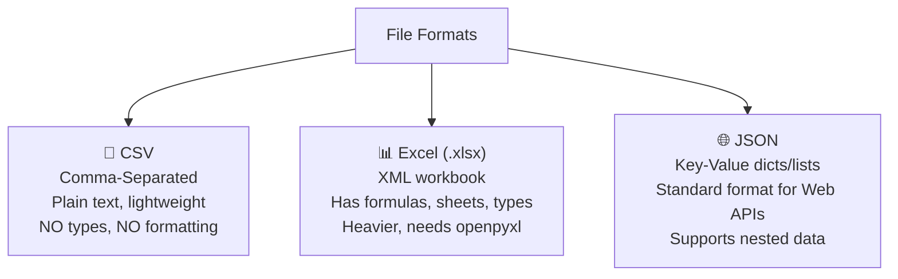
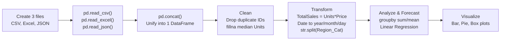
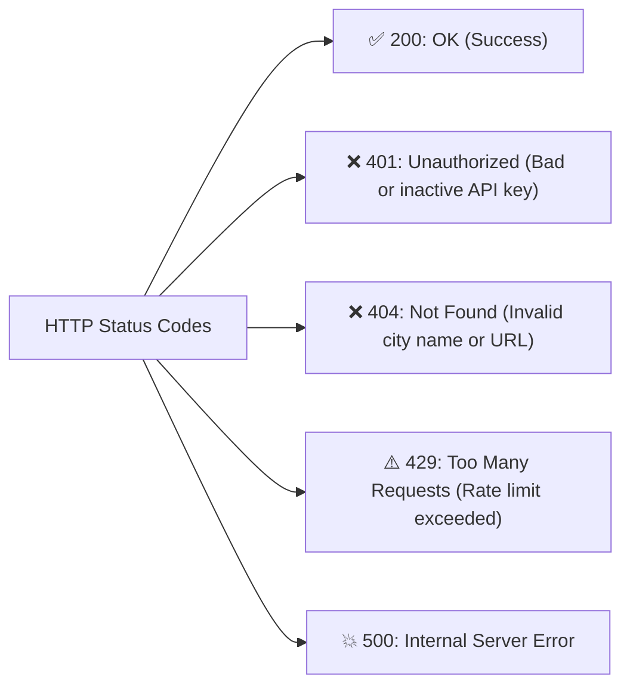
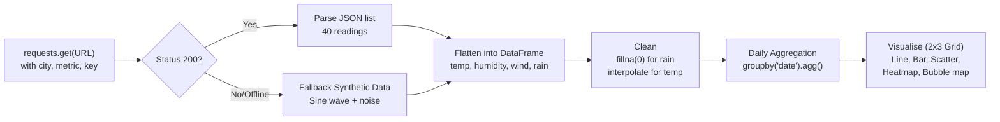
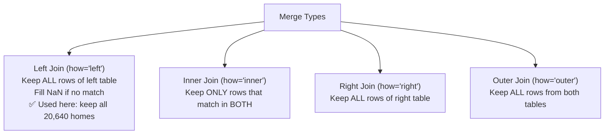
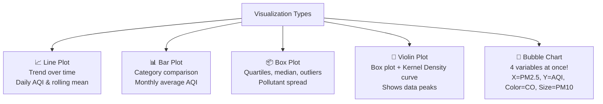
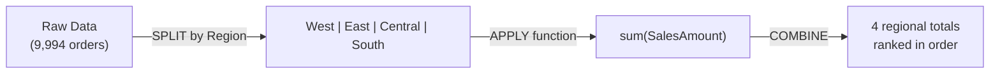
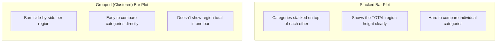
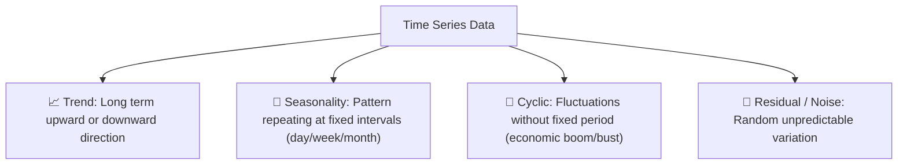

# 🎯 DMV Practicals — Complete Exam Guide (Assignments 1 to 7)

> [!TIP]
> **Exam Strategy**:
> 1. Look at each practical's **Pipeline Diagram** first to understand the flow.
> 2. Read the **"What it is in one line"** and the concept breakdown.
> 3. Memorize the **Key Numbers & Quick Viva Table** — that's 90% of what external examiners ask!

---

## Practical 1 — Multi-Format Sales (CSV, Excel, JSON) 📊

### What is Practical 1 in one line?
**Load sales data from 3 different file types (CSV, Excel, JSON), clean and merge them into one table, analyze sales, and plot graphs.**

---

### 📘 File Formats Compared (CSV vs Excel vs JSON)



| Format | Pros | Cons | Pandas Function |
|--------|------|------|-----------------|
| **CSV** | Tiny, universal, fast to load | No data types (all text), no multiple sheets | `pd.read_csv("sales.csv")` |
| **Excel (.xlsx)** | Formats, formulas, business friendly | Slow, larger size, needs `openpyxl` | `pd.read_excel("sales.xlsx")` |
| **JSON** | Hierarchical, standard for web APIs | Verbose, harder to flatten when nested | `pd.read_json("sales.json")` |

---

### 📘 Key Concepts Explained Simply

#### 1. `pd.concat()` vs `pd.merge()`
- **`concat()`**: Stacks tables on top of each other (like putting sheets of paper in a stack) when column names match. Used here to combine CSV + Excel + JSON:
  ```python
  df = pd.concat([csv_df, xls_df, json_df], ignore_index=True)
  ```
- **`merge()`**: Joins tables side-by-side using a shared **key column** (like SQL `JOIN`).

#### 2. Handling Missing Values (`fillna`)
- **Mean**: Average of numbers — gets pulled by extreme values/outliers!
- **Median**: Middle value — robust against outliers. We use median for missing `Units`:
  ```python
  df["Units"] = df["Units"].fillna(df["Units"].median())
  ```
- **Mode**: Most frequent value — used for categorical text columns.

#### 3. Handling Duplicates (`drop_duplicates`)
- We drop duplicates by the unique order ID (`subset=["ID"]`), not by whole row, because two rows might differ slightly due to a typo but represent the same order:
  ```python
  df = df.drop_duplicates(subset=["ID"]).copy()
  ```

#### 4. Feature Engineering & Date Splitting
- Derived variable: `TotalSales = Units * Price`
- Dates converted via `pd.to_datetime()` so `.dt` accessor can extract parts:
  ```python
  df["Month"] = df["Date"].dt.month_name()
  df["Year"] = df["Date"].dt.year
  ```
- Splitting strings: `str.split("-", expand=True)` splits `"Region-Cat"` into 2 separate columns (`Reg` and `Category`).

#### 5. When to use which chart?
- **Bar Chart**: Compare discrete categories (e.g., Total revenue by Category).
- **Pie Chart**: Share of a whole (use only with few categories, e.g., 4 regions).
- **Box Plot**: Distribution, median, spread, and outliers of a numeric variable across groups.

---

### Pipeline Diagram



---

### Key Numbers to Remember
- Total rows generated: **7** (3 CSV with 1 duplicate, 2 Excel, 2 JSON) → **6 rows** after dropping duplicate ID `2`.
- Missing Units filled with median: **18**.
- Total Revenue: **$22,110.00** | Average Order Value: **$3,685.00**.
- Top Category: **Tech ($17,000)** | Top Region: **West ($11,000)**.
- Correlation `TotalSales` vs `AdSpend`: **+0.788** (strong positive correlation).

---

### Quick Viva Q&A

| Question | Best Answer |
|----------|-------------|
| Why use `index=False` in `to_csv()`? | Prevents pandas from saving unwanted 0, 1, 2... row index numbers into the file. |
| What does `expand=True` do in `str.split()`? | Returns a DataFrame with separate columns instead of a single column of lists. |
| Why is `.copy()` used after `drop_duplicates()`? | Creates an independent DataFrame to avoid `SettingWithCopyWarning`. |
| Concat vs Merge? | `concat` stacks rows vertically; `merge` joins tables horizontally on a shared key. |
| Why median instead of mean? | Median is not pulled by extreme high or low outlier values. |

---

## Practical 2 — Web APIs (Weather from OpenWeatherMap) 🌦️

### What is Practical 2 in one line?
**Fetch 5-day / 3-hour live weather forecast from OpenWeatherMap REST API via HTTP GET, clean and flatten nested JSON, aggregate daily, and visualize.**

---

### 📘 Key Concepts Explained Simply

#### 1. What is an API and REST?
- **API (Application Programming Interface)**: A messenger that lets our Python script request data from OpenWeatherMap's server.
- **REST (Representational State Transfer)**: Architectural style using standard HTTP verbs:
  - `GET`: Read / retrieve data (what we use)
  - `POST`: Create new data
  - `PUT`: Update data
  - `DELETE`: Remove data
- REST is **stateless** — every request contains all info (API key, city, units) needed.

#### 2. HTTP Status Codes



#### 3. API Key & Security
- Never hardcode API keys in source code!
- Read via environment variables: `os.getenv("OPENWEATHER_API_KEY", "")`.
- If key is missing or offline, the script falls back to **synthetic/simulated data** (40 readings) using numpy sine waves so the assignment runs smoothly offline!

#### 4. Handling Nested JSON Data
- Weather API returns deeply nested JSON:
  `item["main"]["temp"]`, `item["wind"]["speed"]`
- For rain: Rain only appears when raining! Using `item["rain"]["3h"]` would crash with `KeyError` on dry days.
  Solution: `item.get("rain", {}).get("3h", 0.0)`.

#### 5. API Data Cleaning
- Missing rain is filled with `0.0` (dry day).
- Missing temperature/wind is **interpolated** (`interpolate().bfill()`), NOT filled with 0 (because 0°C is a real freezing temperature, not missing!).

---

### Pipeline Diagram



---

### Key Numbers to Remember
- Forecast structure: **5 days × every 3 hours = 40 records**.
- Synthetic temperature baseline: **~28°C** with sine wave variation.
- Correlation temp vs humidity: **~ -0.95** (strong negative: as air warms, relative humidity drops).

---

### Quick Viva Q&A

| Question | Best Answer |
|----------|-------------|
| What does `timeout=10` do? | Stops the script from hanging indefinitely if the remote server fails to respond. |
| Why `item.get("rain", {})`? | Rain key is absent on sunny days; `.get()` prevents a `KeyError`. |
| Why not fill missing temperature with 0? | 0°C is freezing point, a valid measurement. Interpolation estimates realistic values. |
| What does `np.polyfit()` do? | Fits a linear line ($y = mx + c$) to find temperature trend slope over time. |
| Difference between live and synthetic data? | Live comes from real API calls; synthetic uses mathematical formulas when offline. |

---

## Practical 3 — Data Cleaning & Preparation (Telecom Churn) 📱

### What is Practical 3 in one line?
**Clean messy telecom customer data (blank strings, outliers, inconsistent text), engineer new features, encode and scale, and prepare it for machine learning.**

---

### 📘 Data Cleaning vs Data Preparation

```mermaid
flowchart LR
    subgraph Cleaning["1. Data Cleaning (Fixing Errors)"]
        direction TB
        C1["Convert hidden blanks ' ' to NaN"]
        C2["Impute missing TotalCharges"]
        C3["Remove duplicate customerIDs"]
        C4["Standardize text with str.strip() & replace()"]
        C5["Cap outliers using IQR fences"]
    end
    subgraph Prep["2. Data Preparation (Model Ready)"]
        direction TB
        P1["Feature Engineering: AvgMonthlySpend, TenureGroup"]
        P2["One-Hot Encoding: pd.get_dummies(drop_first=True)"]
        P3["Train/Test Split: stratify=y"]
        P4["StandardScaler: fit on TRAIN only!"]
        P5["Export clean CSV"]
    end
    Cleaning --> Prep
```



---

### 📘 Key Concepts Explained Simply

#### 1. Hidden Missing Values (Blank Strings `" "`)
- In `TotalCharges`, 11 new customers had `" "` (space text). `isnull()` sees it as valid string!
- Solution:
  ```python
  df["TotalCharges"] = pd.to_numeric(df["TotalCharges"], errors="coerce")
  ```
  `errors="coerce"` turns invalid text into `NaN`.
- We impute with `tenure * MonthlyCharges` because tenure is 0 for new customers (they paid $0).

#### 2. Outliers: IQR Method vs Z-Score
- **IQR (Interquartile Range)**:
  $$\text{IQR} = Q_3 - Q_1$$
  Lower Limit = $Q_1 - 1.5 \times \text{IQR}$, Upper Limit = $Q_3 + 1.5 \times \text{IQR}$
  - Robust against skewed data.
- **Z-Score**: $z = \frac{x - \mu}{\sigma}$. Outlier if $|z| > 3$. Assumes bell curve (normal distribution).
- **Capping / Winsorizing (`clip`)**: Instead of deleting rows and losing customers, we cap extreme values at the upper and lower fences:
  ```python
  df[col] = df[col].clip(lo, hi)
  ```

#### 3. One-Hot Encoding & Dummy Variable Trap
- Models cannot read text categories like `"DSL"`, `"Fiber optic"`.
- `get_dummies(drop_first=True)` converts categories into $0/1$ indicator columns.
- **Dummy Variable Trap**: If a category has 3 options and you keep all 3 dummy columns, they sum to 1 (perfect multicollinearity). `drop_first=True` drops the first column to prevent this.

#### 4. Data Leakage & Scaler Fitting
- **Rule**: Never fit the scaler on the whole dataset!
- Fit on `X_train` only (`sc.fit(X_train)`), then `transform` both train and test. If test data influences mean/std, it's **data leakage**.

---

### Key Numbers to Remember
- Rows: **7,043 customers**, 21 columns.
- Missing values in `TotalCharges`: **11 rows** (all with `tenure = 0`).
- Target variable: `Churn` (Yes = 1, No = 0).
- Churn Rate: **26.5%** (imbalanced dataset → why `stratify=y` is needed).
- Train/Test Split: **80% train (5634 rows) / 20% test (1409 rows)**.
- Final encoded feature count: **27 columns**.

---

### Quick Viva Q&A

| Question | Best Answer |
|----------|-------------|
| Why did `isnull()` miss blank TotalCharges? | Spaces `" "` are considered non-null strings; `to_numeric(errors='coerce')` converts them to `NaN`. |
| Why cap outliers with `clip()` instead of deleting? | Deleting removes valuable customer records; capping retains the data while taming extremes. |
| What does `stratify=y` do? | Preserves the 26.5% churn ratio equally in both train and test sets. |
| What is the dummy variable trap? | Multicollinearity caused by keeping all dummy columns; resolved by `drop_first=True`. |
| Why fit scaler only on training data? | To prevent **data leakage** from the unseen test set into model training. |

---

## Practical 4 — Data Wrangling (California Real Estate) 🏡

### What is Practical 4 in one line?
**Clean messy column headers, impute missing bedrooms, merge risk lookup tables, filter subsets, encode categories, and aggregate housing prices.**

---

### 📘 Key Concepts Explained Simply

#### 1. What is Data Wrangling?
Transforming messy, raw data into a clean, unified format suitable for downstream analytics and machine learning.

#### 2. Standardizing Column Names
Raw columns often have spaces or symbols (e.g., `"Total Rooms!"`).
Clean with regex:
```python
df.columns = (df.columns.str.strip().str.lower()
              .str.replace(r"[^\w\s]", "", regex=True)
              .str.replace(r"\s+", "_", regex=True))
```
Results in clean names: `median_house_value`, `ocean_proximity`.

#### 3. Joins / Merges: Left vs Inner vs Outer



#### 4. Boolean Indexing (Filtering)
To filter expensive and new homes:
```python
subset = df[(df["median_house_value"] > 200000) & (df["housing_median_age"] < 20)]
```
- Must use bitwise `&` (and) or `|` (or), NOT python keywords `and`/`or`.
- Every condition **must be wrapped in parentheses `()`** due to operator precedence!

#### 5. Binning with `pd.cut()`
Converts continuous numbers (house age) into distinct categorical age bands:
`(0, 10]`, `(10, 20]`, `(20, 35]`, `(35, 60]`.

---

### Key Numbers to Remember
- Dataset: **20,640 rows** (California 1990 census blocks).
- Missing values: **207 missing in `total_bedrooms`** → filled with median (`435.0`).
- Expensive & New homes: **2,186 properties** out of 20,640.
- Outliers in house value: **1,071 rows** capped at upper fence of **$482,412**.

---

### Quick Viva Q&A

| Question | Best Answer |
|----------|-------------|
| Why merge on a key instead of row position? | Position merging can misalign data if rows change order. Key matching guarantees correct pairing. |
| Why use parentheses `()` in pandas filters? | In Python, `&` has higher precedence than `>` or `<`; brackets ensure comparisons evaluate first. |
| What does `observed=True` do in `groupby`? | Shows only categories that actually exist in the data, suppressing future deprecation warnings. |
| Label Encoding vs One-Hot Encoding? | Label gives 0, 1, 2 (implies order, good for trees). One-Hot gives binary columns (no order, safe for linear models). |

---

## Practical 5 — Data Visualization using Matplotlib (AQI Trends) 🌫️

### What is Practical 5 in one line?
**Analyze Delhi air pollution using Matplotlib: plot daily trends, 14-day rolling averages, monthly comparisons, box/violin distributions, and bubble charts.**

---

### 📘 Chart Types & When to Use



| Chart | What it shows best | In our code |
|-------|-------------------|-------------|
| **Line Plot** | Continuous movement over time | Daily AQI + 14-day moving average |
| **Bar Plot** | Discrete group comparison | Monthly average AQI |
| **Box Plot** | Median, IQR spread, outliers | PM2.5 spread across AQI categories |
| **Violin Plot** | Distribution shape & multiple peaks | PM10 spread across AQI categories |
| **Bubble Chart** | 4 dimensions on 2D screen! | X=PM2.5, Y=AQI, Color=CO, Size=PM10 |

---

### 📘 Key Concepts Explained Simply

#### 1. What is a Rolling (Moving) Average?
- `df["AQI"].rolling(14).mean()`
- Averages past 14 days of data to **smooth out day-to-day noise** so the true underlying trend is visible.
- The first 13 days will be `NaN` because a full 14-day window hasn't accumulated yet.

#### 2. CPCB AQI Categories (India)
1. **0–50**: Good
2. **51–100**: Satisfactory
3. **101–200**: Moderate
4. **201–300**: Poor
5. **301–400**: Very Poor
6. **401+**: Severe

#### 3. Why PM2.5 and PM10 dominate AQI?
- PM2.5 (particles $\le 2.5\mu m$) and PM10 are the most harmful respirable particles.
- Correlation with AQI in Delhi is **~0.95** (near perfect correlation)!

---

### Key Numbers to Remember
- Sample filtered: **Delhi, latest 365 days** (July 2019 to July 2020).
- Average AQI: **~200.15** (Moderate to Poor).
- Seasonal pattern: Cleanest in **Monsoon (Aug–Sep ~100 AQI)**, worst in **Winter (Nov–Dec ~355 AQI)** due to crop burning and cold stagnant air.
- Correlation with AQI: **PM2.5 = 0.949**, **PM10 = 0.946**, **CO = 0.817**.

---

### Quick Viva Q&A

| Question | Best Answer |
|----------|-------------|
| Difference between `plt.subplot()` and `plt.subplots()`? | `subplot()` adds one axes at a time; `subplots()` creates the full Figure and axes array together in one call. |
| Box plot vs Violin plot? | Box plot shows summary stats (median, IQR, outliers); Violin plot also shows the probability density (distribution shape). |
| What does `alpha=0.7` mean? | Sets transparency (70% opacity) so overlapping dots remain visible. |
| How does the bubble chart show 4 variables? | X-axis = PM2.5, Y-axis = AQI, Dot Color = CO, Bubble Size = PM10. |

---

## Practical 6 — Retail Sales Aggregation (Superstore) 🛒

### What is Practical 6 in one line?
**Aggregate 9,994 retail sales rows using the Split-Apply-Combine pattern to identify top-performing regions and cross-tabulate categories.**

---

### 📘 Key Concepts Explained Simply

#### 1. What is Data Aggregation?
Taking thousands of detailed transaction records and collapsing them into concise summary figures (Totals, Averages, Counts).
In SQL: `GROUP BY`. In Pandas: `df.groupby()`.

#### 2. The Split-Apply-Combine Pattern



#### 3. Stacked Bar vs Grouped Bar Plot



#### 4. `groupby() + unstack()` vs `pivot_table()`
- Both produce the exact same cross-table matrix (Region × Category):
  ```python
  # Method 1
  df.groupby(["Region", "ProductCategory"])["SalesAmount"].sum().unstack(fill_value=0)
  
  # Method 2
  pd.pivot_table(df, index="Region", columns="ProductCategory", values="SalesAmount", aggfunc="sum", fill_value=0)
  ```
- `fill_value=0` replaces missing combinations with 0 instead of `NaN`.

---

### Key Numbers to Remember
- Dataset: **9,994 rows** (Kaggle Superstore dataset).
- Top Performing Region: **West ($725,457.82)** → **31.6% share** of total company revenue.
- Rankings: 1. West, 2. East, 3. Central, 4. South.
- Best selling category: **Technology** in East, Central, South; **Furniture** in West.
- Interesting Insight: South has the fewest orders (1,620) and lowest total sales, but the **highest average order value ($241.80)**.

---

### Quick Viva Q&A

| Question | Best Answer |
|----------|-------------|
| Sum vs Mean as a KPI? | `Sum` shows total business size; `Mean` shows typical transaction value. A region can have high total simply due to high order volume. |
| What does `unstack()` do? | Pivots the inner level of a multi-index Series into columns, turning grouped data into a 2D matrix. |
| Why use `rot=0` in `.plot(kind='bar')`? | Keeps horizontal x-axis labels straight (0° rotation) so they are easy to read. |
| Difference between `count()` and `size()`? | `count()` counts non-null values; `size()` counts total rows including nulls. |

---

## Practical 7 — Stock Time Series Analysis (ARIMA & Holt) 📈

### What is Practical 7 in one line?
**Analyze stock price trends, test for stationarity using ADF, decompose seasonality, and forecast future prices using ARIMA and Exponential Smoothing.**

---

### 📘 Key Concepts Explained Simply

#### 1. Why Time Series is Different from Standard ML
- **Order Matters!** Data is recorded sequentially over time.
- **NEVER randomly shuffle or split time series!**
  - Shuffling creates data leakage (predicting the past using the future).
  - Train/Test split is always **chronological**: Train on past (older data), test on future (latest 30 days).

#### 2. Components of a Time Series



- **Additive Model**: $\text{Value} = \text{Trend} + \text{Seasonal} + \text{Residual}$ (used when amplitude stays constant).
- **Multiplicative Model**: $\text{Value} = \text{Trend} \times \text{Seasonal} \times \text{Residual}$ (used when swings grow as price rises).

#### 3. Moving Averages: SMA vs EMA
- **SMA (Simple Moving Average)**: Equal weight to all days in window.
- **EMA (Exponential Moving Average)**: Gives more weight to recent days (reacts faster).
- **Golden Cross**: Short MA (20-day) crosses **above** Long MA (50-day) → Bullish buy signal!
- **Death Cross**: Short MA crosses **below** Long MA → Bearish sell signal!

#### 4. Stationarity & The ADF Test
- **Stationary series**: Mean, variance, and autocorrelation remain constant over time.
- Stock prices are **NOT stationary** (they drift and trend upwards).
- **ADF (Augmented Dickey-Fuller) Test**:
  - $p\text{-value} \ge 0.05$: NOT stationary (fail to reject null hypothesis).
  - $p\text{-value} < 0.05$: Stationary!
- **Differencing ($d=1$)**: Subtract yesterday's price from today's price ($y_t - y_{t-1}$). First difference becomes stationary!

#### 5. ARIMA(p, d, q) Model
- **AR ($p$)**: AutoRegressive — uses past $p$ values to predict today.
- **I ($d$)**: Integrated — number of differencing steps to achieve stationarity ($d=1$).
- **MA ($q$)**: Moving Average — uses past $q$ forecast errors.
- We use **ARIMA(5, 1, 0)**: 5 past days, 1 difference, 0 error terms.

#### 6. Exponential Smoothing (Holt's Linear Trend)
- Weighted average where weights decay exponentially the further back in time you go.
- Holt's method captures both **Level** and **Trend**.

#### 7. Why are stock forecasts usually flat?
Stock prices resemble a **random walk** (efficient market hypothesis). The mathematically best forecast is "approximately today's price plus minor drift", and the 95% confidence interval widens like a cone over time!

---

### Key Numbers to Remember
- Data: **10,238 trading days** (Microsoft / MSFT stock data, 1986–2026).
- Golden Crosses: **114 upward crossovers** of MA20 over MA50.
- ADF $p$-value on raw price: **0.999** (NOT stationary).
- ADF $p$-value on 1st difference: **0.0000** (Stationary! Justifies $d=1$).
- Forecast Horizon: **30 business days**.
- Test performance: Both ARIMA and Exponential Smoothing achieve **~5% MAPE**.

---

### Quick Viva Q&A

| Question | Best Answer |
|----------|-------------|
| Why must time series test sets be at the end? | Random splits cause data leakage by letting future data train past predictions. |
| What does $d=1$ mean in ARIMA(5, 1, 0)? | The series was differenced once ($y_t - y_{t-1}$) to make it stationary. |
| What is the ADF test null hypothesis? | That the series has a unit root (is non-stationary). $p < 0.05$ rejects it. |
| What is `asfreq("B").ffill()`? | Enforces business-day frequency and forward-fills missing days (holidays/weekends). |
| RMSE vs MAE vs MAPE? | MAE is average absolute dollar error; RMSE penalizes large errors more; MAPE is error as a percentage. |

---

## 🗺️ DMV Practicals Cheat Sheet (All 7 at a Glance)

| # | Topic | Key Operation | Dataset | Main Method / Tool | Key Result / Metric |
|---|-------|---------------|---------|--------------------|---------------------|
| **1** | Multi-Format Sales | Load & Unify | CSV, Excel, JSON (7 rows) | `pd.concat()`, `drop_duplicates` | $22,110 Total Revenue |
| **2** | Weather API | Web REST API | OpenWeatherMap (40 readings) | `requests.get()`, nested JSON | Temp vs Humid $r \approx -0.95$ |
| **3** | Telecom Churn | Cleaning & Prep | Telco Churn (7,043 rows) | `to_numeric`, `clip`, `get_dummies` | 26.5% churn, 0 nulls left |
| **4** | Real Estate | Data Wrangling | CA Housing (20,640 rows) | `merge(how='left')`, `pd.cut()` | 2,186 expensive & new homes |
| **5** | AQI Trends | Visualization | Delhi Air Quality (365 days) | Matplotlib subplots, rolling mean | PM2.5 correlation with AQI: 0.95 |
| **6** | Retail Sales | Aggregation | Superstore (9,994 rows) | `groupby()`, `unstack()` | West region #1 (31.6% share) |
| **7** | Stock Analysis | Time Series | Stock Prices (10,238 days) | ADF test, ARIMA(5,1,0), Holt | $p=0.000$ on diff, MAPE ~5% |

---

> [!IMPORTANT]
> **Universal Pandas Checklist for DMV Practicals**:
> 1. `df.info()` & `df.shape` — check column types & size
> 2. `df.isnull().sum()` — count missing values
> 3. `df.drop_duplicates()` — clean repeated rows
> 4. `pd.to_datetime()` — always convert date text before time operations
> 5. `df.groupby().agg()` — for any group summary
> 6. `plt.tight_layout()` & `plt.show()` — cleanly format any plot

Good luck with your practical exam! You've got this! 🌟
