# 🎯 ML Practicals — Complete Exam Guide

> [!TIP]
> Read each practical's **"What's Happening"** diagram first, then the simple explanation, then glance at the code walkthrough. That's enough to answer any viva question confidently.

---

## Practical 1 — PCA (Principal Component Analysis) on Wine 🍷

### What is PCA in one line?
**PCA squishes many columns into fewer columns while keeping the most important information.**

Think of it like this: you have 13 measurements about wine (alcohol, color, etc.). PCA says *"I can describe most of this info using just 2 new numbers instead of 13."*

---

### 📘 What is Variance?

Variance = **how spread out** the numbers are.

| Data | Spread | Variance |
|------|--------|----------|
| [5, 5, 5, 5] | No spread at all | **0** (boring, no info) |
| [1, 3, 7, 9] | Very spread out | **High** (lots of info!) |

PCA looks for directions where data is **most spread** (most variance) because that's where the **most information** lives.

---

### 📘 What is a Covariance Matrix?

It's a table that shows **how features move together**:

| | Alcohol | Color | Hue |
|---|---|---|---|
| **Alcohol** | var(Alcohol) | cov(Alc,Color) | cov(Alc,Hue) |
| **Color** | cov(Color,Alc) | var(Color) | cov(Color,Hue) |
| **Hue** | cov(Hue,Alc) | cov(Hue,Color) | var(Hue) |

- **Diagonal** = variance of each feature
- **Off-diagonal** = how two features move together (positive = together, negative = opposite)
- PCA decomposes this matrix to find the best directions

---

### 📘 What are Eigenvectors and Eigenvalues?

When PCA breaks down the covariance matrix:

| Concept | What it is | Analogy |
|---------|-----------|---------|
| **Eigenvector** | The **direction** of a Principal Component | Which way to point the camera |
| **Eigenvalue** | How much **variance** is along that direction | How interesting the view is |

- Bigger eigenvalue = more important direction = keep it
- Smaller eigenvalue = less info = can drop it

---

### 📘 What is Explained Variance Ratio?

$$\text{Explained Variance Ratio of PC}_i = \frac{\text{Eigenvalue}_i}{\text{Sum of all Eigenvalues}}$$

| PC | Eigenvalue (variance) | Ratio | Meaning |
|----|----------------------|-------|---------|
| PC1 | Biggest | **0.362 (36.2%)** | This direction holds 36.2% of all info |
| PC2 | Next | **0.192 (19.2%)** | Another 19.2% |
| PC1+PC2 | — | **55.41%** | Together they capture 55% of everything |
| All 13 | — | **100%** | No info lost |

**Rule of thumb:** Keep enough PCs to reach **90–95%** cumulative variance.

---

### 📘 What is Dimensionality Reduction?

Going from **many features → fewer features** while losing as little info as possible.

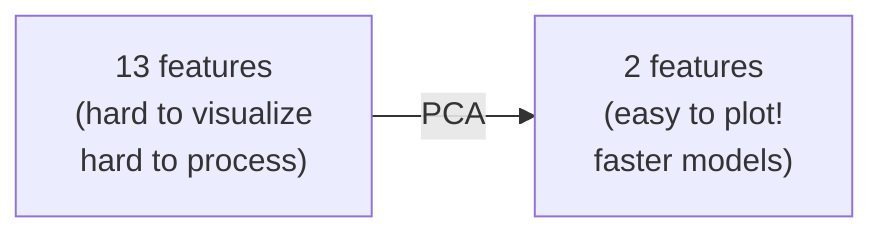

**Why do it?**
- Can't plot 13 dimensions on paper
- Removes noise and redundant features
- Speeds up other ML algorithms
- Reduces overfitting

---

### 📘 PCA vs LDA — Key Difference

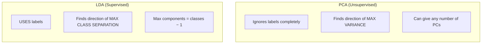

| | PCA | LDA |
|---|---|---|
| **Uses labels?** | ❌ No (unsupervised) | ✅ Yes (supervised) |
| **Goal** | Max total variance | Max between-class / within-class separation |
| **Max components** | = number of features | = number of classes − 1 |
| **Use when** | Compress / visualize | Classify |

---

### The Pipeline

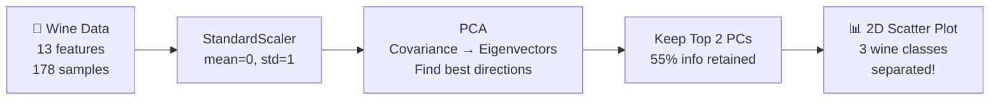

### Step-by-Step Code Walkthrough

| Step | Code | What it does |
|------|------|-------------|
| 1 | `pd.read_csv(url)` | Load 178 wines × 14 columns |
| 2 | `y = df.iloc[:, 0]`, `X = df.iloc[:, 1:]` | Split: column 0 = label (1/2/3), rest = features |
| 3 | `StandardScaler().fit_transform(X)` | Scale all features to mean=0, std=1 |
| 4 | `PCA().fit(X_scaled)` | Fit all 13 PCs, see how much variance each holds |
| 5 | `PCA(n_components=2).fit_transform()` | Keep only top 2 PCs → shape becomes (178, 2) |
| 6 | `plt.scatter(...)` | Plot PC1 vs PC2, colored by wine class |

### 📘 What does `fit` vs `transform` vs `fit_transform` mean?

| Method | What it does |
|--------|-------------|
| `fit(X)` | **Learn** the parameters (mean, std, eigenvectors) from data |
| `transform(X)` | **Apply** those learned parameters to data |
| `fit_transform(X)` | **Both** in one step — learn AND apply |

On **new data** you only call `transform()` (don't re-learn!).

### Quick Viva Answers

| Question | Answer |
|----------|--------|
| Supervised or Unsupervised? | **Unsupervised** — never uses labels |
| What are eigenvalues? | The amount of variance along each PC direction |
| What are eigenvectors? | The **directions** of the principal components |
| What is explained variance ratio? | Eigenvalue / sum of all eigenvalues — tells how much info each PC holds |
| PCA vs LDA? | PCA = unsupervised, max variance. LDA = supervised, max class separation |
| Why scale before PCA? | PCA follows variance; big features (Proline ~1000) would dominate small ones (Hue ~1) |
| Why no train/test split? | We're only transforming & visualizing, not predicting |
| Shape of X_pca? | **(178, 2)** — 178 samples, 2 principal components |
| How many PCs for 95%? | About **10 PCs** |
| Are PCs correlated? | **No** — they are orthogonal (perpendicular), meaning uncorrelated |

---

## Practical 2 — Regression (Uber Fare Prediction) 🚕

### What is Regression in one line?
**Predict a continuous number (fare in $) from input features (distance, time, etc.).**

---

### 📘 What is Linear Regression?

It fits a **straight line** (or flat surface in many dimensions) through the data:

$$y = w_1 x_1 + w_2 x_2 + \ldots + w_n x_n + b$$

- Each $w$ (weight) says **how much** that feature affects the fare
- $b$ (bias/intercept) is the starting fare when all features = 0
- It finds the best weights by **minimizing the sum of squared errors** (called Ordinary Least Squares / OLS)

**Simple example:** If distance has weight 2.5 and bias is 3:
> fare = 2.5 × distance + 3
> A 4 km ride → 2.5 × 4 + 3 = **\$13**

---

### 📘 What is Ridge Regression (L2)?

Same as Linear but adds a **penalty on large weights**:

$$\text{Loss} = \text{Squared Errors} + \alpha \times \sum w_i^2$$

- **α (alpha = 1.0)** controls penalty strength
- It **shrinks** all weights toward zero, but **never makes them exactly zero**
- Good when features are **correlated** with each other (multicollinearity)

**Analogy:** *"You can use all features, but keep your weights small and humble."*

---

### 📘 What is Lasso Regression (L1)?

Adds a **different penalty** — on the absolute values:

$$\text{Loss} = \text{Squared Errors} + \alpha \times \sum |w_i|$$

- **α (alpha = 0.01)** — small here because Lasso is aggressive
- It can push some weights to **EXACTLY zero** → those features are dropped
- So Lasso does **automatic feature selection**!

**Analogy:** *"You must keep weights small, and some features deserve to be fired entirely."*

---

### 🔺 Linear vs Ridge vs Lasso — Side by Side

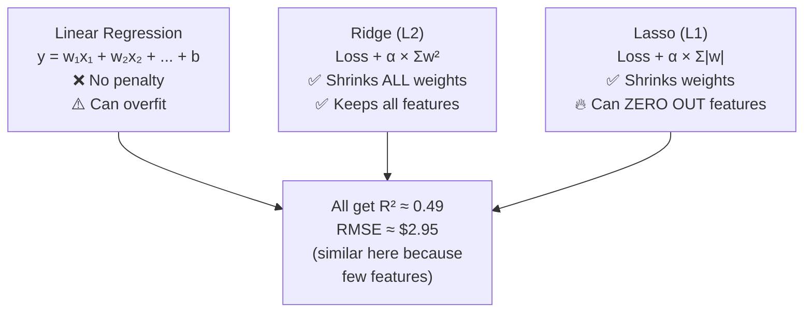

| | Linear | Ridge (L2) | Lasso (L1) |
|---|---|---|---|
| **Penalty** | None | α × Σw² | α × Σ\|w\| |
| **Weights** | Can be big | All shrunk, none zero | Some become **exactly 0** |
| **Feature selection?** | ❌ No | ❌ No | ✅ Yes |
| **Best when** | Simple, few features | Correlated features | Want to drop useless features |
| **Our α** | — | 1.0 | 0.01 |

---

### 📘 What is R² (R-squared)?

$$R^2 = 1 - \frac{\text{Model's errors}}{\text{Errors if you just predicted the mean}}$$

| R² Value | Meaning |
|----------|---------|
| **1.0** | Perfect — model explains 100% of variation |
| **0.49** (ours) | Model explains 49% — rest is unknown factors (traffic, surge) |
| **0.0** | Model is no better than just saying "average fare" every time |
| **Negative** | Model is WORSE than the average — something is very wrong |

**Simple analogy:** If you have a test out of 100, R² = 0.49 means your model scored 49/100. Not great, but it's learning *something*.

---

### 📘 What is RMSE (Root Mean Square Error)?

$$\text{RMSE} = \sqrt{\frac{1}{n}\sum(y_{\text{actual}} - y_{\text{predicted}})^2}$$

Step by step:
1. For each ride: (actual fare − predicted fare)² → square the error
2. Take the **mean** of all squared errors → that's MSE
3. Take the **square root** → that's RMSE

| Metric | Our Value | Unit | Meaning |
|--------|----------|------|---------|
| MSE | ~8.73 | dollars² | Hard to interpret (squared dollars??) |
| **RMSE** | **\$2.95** | **dollars** | On average, prediction is off by about **\$3** |

**Why RMSE not MSE?** → RMSE is in the **same unit** as the target (dollars), so you can directly say *"the model is off by \$3 on average."*

---

### 📘 What is the Haversine Formula?

It calculates the **real-world distance** between two points on Earth using latitude/longitude:

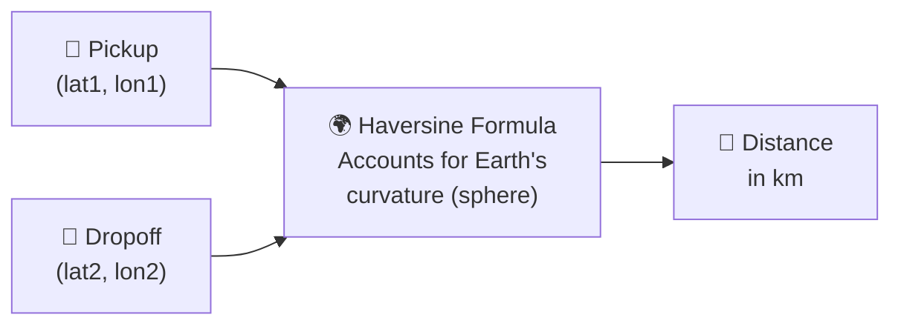

**Why do we need it?**
- Raw lat/lon coordinates (like 40.7, −73.9) have **near-zero correlation** with fare
- But **distance** has **0.72 correlation** with fare — much more useful!
- A linear model can't figure out distance from 4 separate coordinates on its own
- So we **engineer** this feature using the formula

**The formula uses:** `sin`, `cos`, `arcsin`, and Earth's radius (6371 km) to account for the curvature of the Earth.

---

### The Full Pipeline

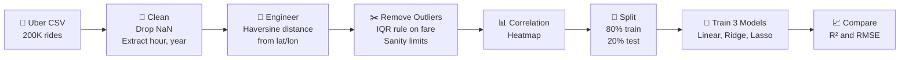

### Quick Viva Answers

| Question | Answer |
|----------|--------|
| Regression vs Classification? | Regression → continuous number. Classification → category |
| L1 vs L2 — which does feature selection? | **L1 (Lasso)** — can push weights to exactly zero |
| Can R² be negative? | Yes! If model is worse than just predicting the mean |
| Why RMSE not MSE? | RMSE is in **same units** as target (dollars), easier to interpret |
| Why all 3 models score similar? | Few features, weak correlations → regularization adds no benefit |
| What is multicollinearity? | Features highly correlated with each other → weights become unstable → Ridge helps |
| Why Lasso α=0.01 and not 1.0? | Lasso is aggressive — high α would zero out everything and underfit |
| Why create distance_km? | Raw lat/lon have ~0 correlation with fare, but distance has **0.72** — much better |

---

## Practical 3 — SVM (Support Vector Machine) on Digits ✋

### What is SVM in one line?
**Find the line (hyperplane) that separates classes with the WIDEST gap (margin).**

---

### 📘 What is a Hyperplane?

A **decision boundary** that separates classes:
- In 2D → it's a **line**
- In 3D → it's a **flat plane**
- In 64D (our digits) → it's a **64-dimensional surface** (hard to imagine, but math handles it!)

---

### 📘 What is Margin?

The **gap/distance** between the hyperplane and the closest points of each class.

```mermaid
flowchart LR
    subgraph Bad["❌ Small Margin"]
        direction TB
        B1["Class A ●●●"]
        B2["──── boundary ────"]
        B3["Class B ○○○"]
    end
    subgraph Good["✅ Maximum Margin"]
        direction TB
        G1["Class A ●●●"]
        G2[""]
        G3["══ WIDE GAP ══"]
        G4[""]
        G5["Class B ○○○"]
    end
```

SVM picks the boundary with the **widest possible gap** → more confident, generalizes better.

---

### 📘 What are Support Vectors?

The **closest points** to the boundary — they sit right on the edge of the margin.

| Concept | Explanation |
|---------|------------|
| **Support Vectors** | The few critical points that **define** the boundary |
| **Other points** | Could be removed without changing anything |
| **Why "support"?** | They **support** (hold up) the boundary — move them and the boundary moves |

> Only ~5–10% of training points are support vectors. The rest don't matter!

---

### 📘 What is the Kernel Trick?

**Problem:** Some data can't be separated by a straight line (like a donut shape).

**Solution:** The kernel trick maps data to a **higher dimension** where it BECOMES separable — without actually computing the new coordinates!

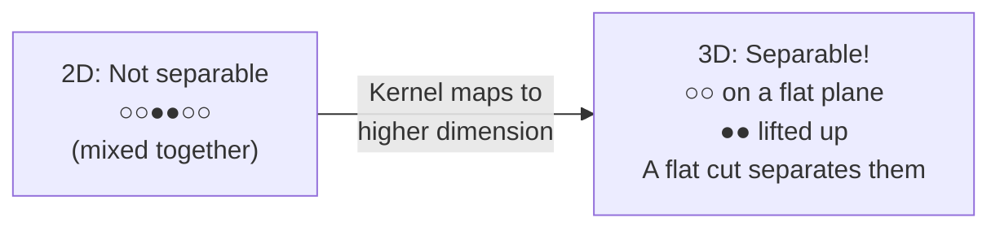

| Kernel | Boundary Shape | Accuracy (our digits) |
|--------|---------------|----------------------|
| **Linear** | Straight line/plane | 0.9800 |
| **Poly** | Curved (polynomial) | 0.9711 |
| **RBF** ⭐ | Flexible curves (Gaussian bell) | 0.9800 |
| **Sigmoid** | S-shaped | 0.9467 |

---

### 📘 What is C (Regularization Parameter)?

C controls the **trade-off between wide margin and fewer mistakes**:

| C Value | Margin | Training Errors | Risk |
|---------|--------|----------------|------|
| **Small C** (e.g., 0.1) | Wide | More errors allowed | **Underfit** (too simple) |
| **Large C** (e.g., 1000) | Narrow | Very few errors | **Overfit** (memorizes noise) |
| **Our C = 10** | Balanced | Good trade-off | ✅ Just right |

**Analogy:** Small C = chill teacher (allows mistakes), Large C = strict teacher (punishes every mistake).

---

### 📘 What is Gamma?

Gamma controls **how far the influence of one training point reaches** (only for RBF/poly/sigmoid):

| Gamma | Influence | Boundary | Risk |
|-------|-----------|----------|------|
| **Small** | Far reach | Smooth, simple | Underfit |
| **Large** | Only nearby | Wiggly, complex | Overfit |
| **"scale"** (ours) | Automatic: 1/(n_features × var) | Balanced | ✅ |

---

### 📘 What is Precision, Recall, and F1?

| Metric | Formula | Meaning | Example |
|--------|---------|---------|---------|
| **Precision** | TP / (TP + FP) | Of all I **predicted** as digit 8, how many are really 8? | "Am I right when I say 8?" |
| **Recall** | TP / (TP + FN) | Of all **actual** 8s, how many did I find? | "Did I find all the 8s?" |
| **F1 Score** | 2 × (P × R) / (P + R) | Balance of both | High only if BOTH are high |

**TP** = True Positive, **FP** = False Positive, **FN** = False Negative

---

### 📘 What is a Confusion Matrix?

A table showing **actual vs predicted** for every class:

| | Pred 0 | Pred 1 | Pred 2 | ... |
|---|---|---|---|---|
| **Actual 0** | ✅ 45 | 0 | 0 | |
| **Actual 1** | 0 | ✅ 44 | 1 | |
| **Actual 2** | 0 | 0 | ✅ 45 | |

- **Diagonal** = correct predictions ✅
- **Off-diagonal** = mistakes (e.g., an actual 1 predicted as 2)
- You can see **which specific classes** get confused

---

### The Pipeline

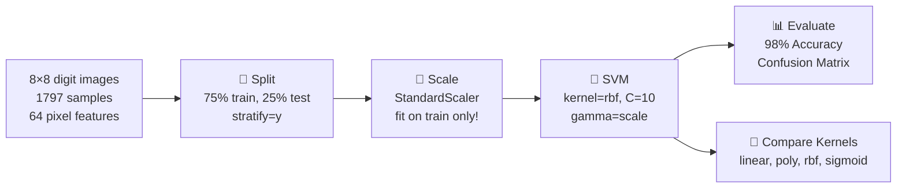

### Quick Viva Answers

| Question | Answer |
|----------|--------|
| What are support vectors? | Points **closest** to the boundary — they alone define it |
| Hard vs Soft margin? | Hard = no errors allowed. Soft = some errors OK (controlled by C) |
| What is the kernel trick? | Maps data to higher dimension where it becomes separable, without computing new coords |
| Why scale for SVM? | SVM uses **distances** — big features would dominate |
| How does SVM handle 10 classes? | **One-vs-One**: 45 binary classifiers, then voting |
| What does stratify=y do? | Keeps same digit proportions in train and test sets |
| Why fit scaler on train only? | To prevent **data leakage** — test data must stay unseen |
| Precision vs Recall? | Precision = "Am I right?" Recall = "Did I find all?" |
| What does confusion matrix show that accuracy doesn't? | **Which specific digits** get confused with each other |
| Why is X_te[i:i+1] not X_te[i]? | `predict()` needs 2D array (1,64). `X_te[i]` is 1D → error |

---

## Practical 4 — K-Means Clustering on Iris 🌸

### What is K-Means in one line?
**Group data into k clusters by repeatedly assigning points to the nearest center and updating centers.**

---

### 📘 What is Clustering?

**Grouping similar things together WITHOUT any labels.** You don't tell the algorithm "this is species A" — it figures out groups by itself.

| Supervised (Classification) | Unsupervised (Clustering) |
|---|---|
| You give labels: "this is cat, this is dog" | No labels given |
| Model learns to predict labels | Model finds natural groups |
| Evaluated by accuracy | Evaluated by silhouette, WCSS |

---

### 📘 How does K-Means Work? (The Algorithm)

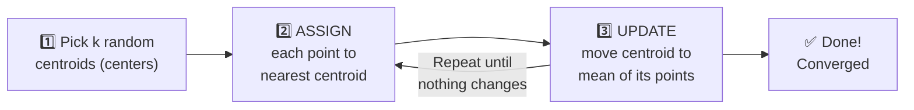

**Step-by-step example with k=3:**
1. Drop 3 random pins on the data (initial centroids)
2. Every point looks at all 3 pins → joins the **nearest** one
3. Each pin **moves** to the center (mean) of its group
4. Points re-check which pin is nearest → some switch groups
5. Pins move again... repeat until nobody switches = **converged**

---

### 📘 What is WCSS (Within-Cluster Sum of Squares) / Inertia?

$$\text{WCSS} = \sum_{\text{each cluster}} \sum_{\text{each point in cluster}} (\text{point} - \text{centroid})^2$$

| WCSS Value | Meaning |
|-----------|---------|
| **High** | Points are far from their centers → loose, bad clusters |
| **Low** | Points are close to their centers → tight, good clusters |
| **0** | Every point IS a centroid (k = n, useless) |

> WCSS **always decreases** as k increases — so we can't just pick the lowest!

---

### 📘 What is the Elbow Method?

Plot WCSS for different values of k (1 to 10) and look for the **bend**:

| k | WCSS | Drop | What's happening |
|---|------|------|-----------------|
| 1 | 681 | — | Everything in one group |
| 2 | 152 | −529 ⬇️ | Huge improvement |
| **3** | **79** | **−73 ⬇️** | **← ELBOW HERE (bend point)** |
| 4 | 57 | −22 | Small improvement |
| 5 | 47 | −10 | Barely better |

**The elbow = best trade-off** between few clusters and tight clusters. After the elbow, adding more clusters gives diminishing returns.

---

### 📘 What is K-Means++ (Smart Initialization)?

**Problem:** Regular K-Means picks random starting centroids → sometimes they're all in one corner → bad clusters.

**K-Means++ solution:**
1. Pick first centroid randomly
2. Pick next centroid **far away** from existing ones (probability proportional to distance²)
3. Repeat until k centroids are chosen

→ Better starting positions → better final clusters. **Default in sklearn!**

---

### 📘 What is Silhouette Score?

For each point, measure how well it fits in its own cluster vs the nearest other cluster:

$$s = \frac{b - a}{\max(a, b)}$$

Where:
- **a** = average distance to points in **own** cluster (lower = tighter fit)
- **b** = average distance to points in **nearest other** cluster (higher = well separated)

| Silhouette Value | Meaning |
|-----------------|---------|
| **+1** | Perfect — far from other clusters, tight in own |
| **0.553** (ours) | Moderate — reasonable structure |
| **0** | On the border between two clusters |
| **−1** | Wrong cluster — closer to another group |

> Silhouette is an **INTERNAL** metric — no labels needed!

---

### 📘 What is Adjusted Rand Index (ARI)?

Compares clusters with the **true labels** (species) by counting pairs:

| ARI Value | Meaning |
|-----------|---------|
| **1.0** | Perfect match with true species |
| **0.73** (ours) | Good but not perfect (versicolor & virginica overlap) |
| **0.0** | Random grouping |
| **Negative** | Worse than random |

> ARI is an **EXTERNAL** metric — needs true labels to compare against.

---

### 📘 What is a Centroid?

The **center point** of a cluster = the **mean** of all points in that cluster.

| Centroid | Sepal L | Sepal W | Petal L | Petal W | Likely Species |
|----------|---------|---------|---------|---------|---------------|
| Cluster 0 | 5.90 | 2.75 | 4.39 | 1.43 | Versicolor |
| Cluster 1 | 5.01 | 3.43 | 1.46 | 0.25 | Setosa |
| Cluster 2 | 6.85 | 3.07 | 5.74 | 2.07 | Virginica |

---

### 📘 K-Means vs DBSCAN vs Hierarchical

```mermaid
flowchart TD
    subgraph KM["K-Means"]
        direction TB
        K1["Need to choose k"]
        K2["Round clusters only"]
        K3["Fast: O(n×k×iters)"]
        K4["Every point in a cluster"]
    end
    subgraph DB["DBSCAN"]
        direction TB
        D1["No need to choose k"]
        D2["ANY shape clusters"]
        D3["Finds NOISE/outliers"]
        D4["Needs eps and min_samples"]
    end
    subgraph HC["Hierarchical"]
        direction TB
        H1["No need to choose k upfront"]
        H2["Gives a dendrogram (tree)"]
        H3["Slow: O(n²)"]
        H4["Cut tree at any level"]
    end
```

---

### The Full Pipeline

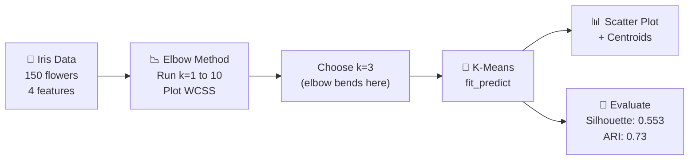

### Quick Viva Answers

| Question | Answer |
|----------|--------|
| Supervised or Unsupervised? | **Unsupervised** — never uses species labels |
| What is WCSS? | Within-Cluster Sum of Squares — lower = tighter clusters |
| What is the elbow method? | Plot WCSS vs k, pick k at the **bend** point |
| What is K-Means++? | Smart initialization — centroids start far apart → better results. Default in sklearn |
| K-Means vs DBSCAN? | K-Means: round clusters, needs k. DBSCAN: any shape, finds noise |
| Why not use accuracy here? | Cluster numbers are arbitrary (cluster 0 ≠ species 0). Use **ARI** |
| What does n_init=10 do? | Run K-Means 10 times, keep the best to avoid bad starts |
| Why no scaling on Iris? | All 4 features are in cm and similar range |
| Silhouette vs ARI? | Silhouette = internal (no labels). ARI = external (needs true labels) |
| Why can't WCSS alone decide k? | It **always** decreases as k increases — so we look for the elbow, not the minimum |

---

## Practical 5 — Random Forest on Car Evaluation 🚗

### What is Random Forest in one line?
**Build 100 decision trees on random subsets of data, then let them VOTE on the answer.**

---

### 📘 What is a Decision Tree?

A flowchart of **if-else questions** that leads to a prediction:

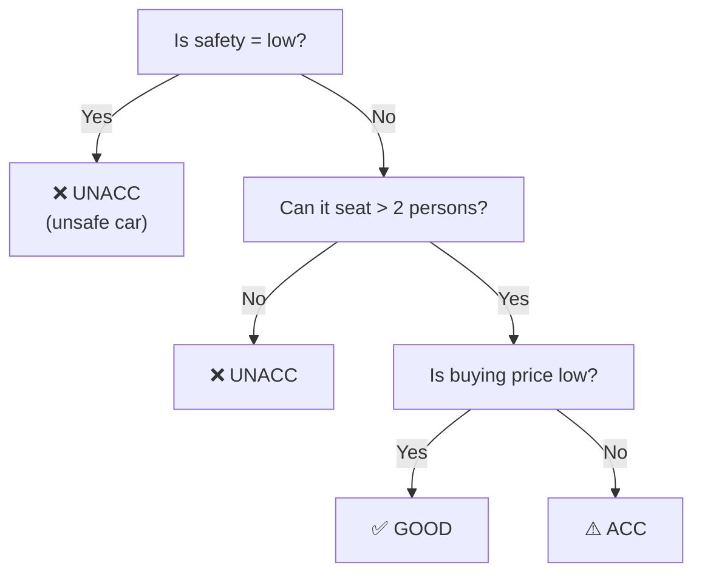

**Problem with ONE tree:** It can grow too deep, memorize the training data, and **overfit**.

---

### 📘 What is an Ensemble?

A **group of models** whose predictions are combined. Instead of trusting one model, ask many and take the majority vote.

**Analogy:** Instead of asking one doctor, ask 100 doctors and go with the majority diagnosis → more reliable!

---

### 📘 What is Bootstrap Sampling?

Randomly pick rows **WITH REPLACEMENT** (same row can be picked twice):

| Original Data | Bootstrap Sample 1 | Bootstrap Sample 2 |
|---|---|---|
| Row A | Row C | Row A |
| Row B | Row A | Row A |
| Row C | Row A | Row D |
| Row D | Row D | Row B |

- Each sample has ~**63%** unique rows (some repeated, some missing)
- The ~**37%** missing rows = **Out-of-Bag (OOB)** samples → free validation!

---

### 📘 What is Bagging (Bootstrap Aggregating)?

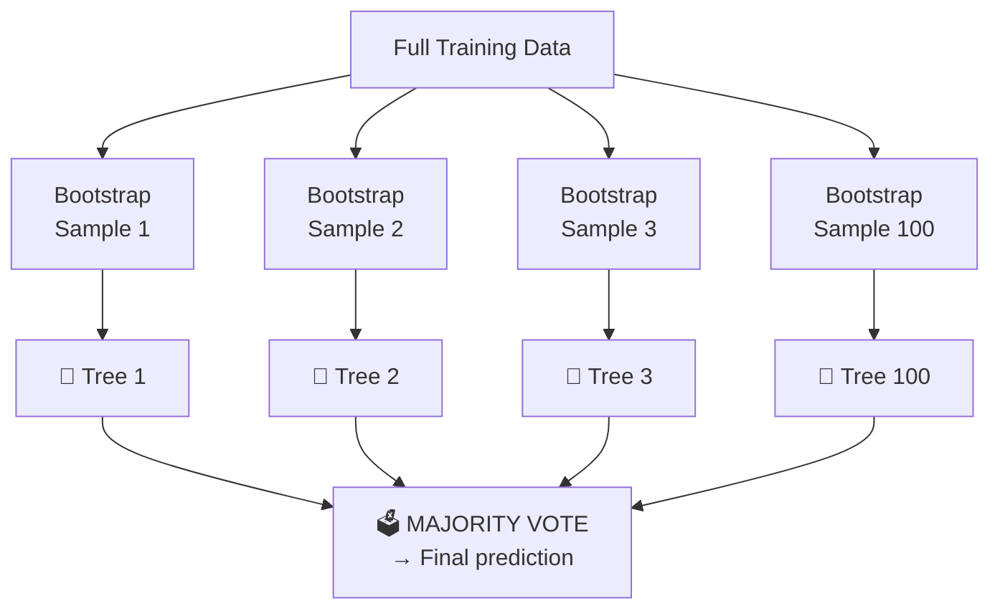

**Bagging = Bootstrap + Aggregating** (combine by voting)

**Random Forest = Bagging + random feature selection at each split**

---

### 📘 Why Random Features at Each Split?

Without it: all 100 trees would pick "safety" first (strongest feature) → all trees look the same → voting doesn't help.

With random features: each tree sees only a **random subset** of features per split → trees become **different** → their mistakes cancel out when voting!

> Default: each split considers √n_features = √6 ≈ 2-3 features randomly

---

### 📘 What is Gini Impurity?

Measures **how mixed** the classes are in a node:

$$\text{Gini} = 1 - \sum p_i^2$$

| Node Content | Gini | Meaning |
|-------------|------|---------|
| All class A (100% pure) | **0.00** | Perfect — no mixing |
| 50% A, 50% B | **0.50** | Maximum confusion |
| 70% unacc, 10% acc, 10% good, 10% vgood | **0.48** | Still mixed |

Trees split on the feature+threshold that **reduces Gini the most**.

---

### 📘 What is Feature Importance?

For each feature, sum up how much it **reduced Gini impurity** across all trees, then normalize to sum = 1:

| Feature | Importance | Why |
|---------|-----------|-----|
| **safety** | 0.306 🥇 | An unsafe car is always unacceptable |
| **persons** | 0.237 🥈 | A 2-seater is limited |
| **maint** | 0.159 🥉 | High maintenance = less acceptable |
| buying | 0.144 | Price matters |
| lug_boot | 0.088 | Luggage space matters less |
| doors | 0.065 | Number of doors matters least |

---

### 📘 What is OOB (Out-of-Bag) Error?

Each tree uses ~63% of rows. The remaining ~37% it **never saw** → use these as a **free test set**!

- Predict OOB rows with the trees that didn't train on them
- Get a validation score without needing a separate test set
- Enable with `oob_score=True` (not used in our code)

---

### 📘 What is Ordinal Encoding?

Converting **ordered categories** to numbers that **keep the order**:

| Category | Ordinal Encoding | ✅ Correct |
|----------|-----------------|-----------|
| low | 0 | |
| med | 1 | |
| high | 2 | |
| vhigh | 3 | |

Without our explicit order, default alphabetical would give: high=0, low=1, med=2, vhigh=3 ← **WRONG order!**

**vs One-Hot Encoding** (for unordered categories like colors):
| Color | Red | Blue | Green |
|-------|-----|------|-------|
| Red | 1 | 0 | 0 |
| Blue | 0 | 1 | 0 |

---

### 📘 Bagging vs Boosting (Very Common Viva!)

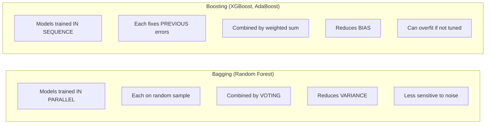

| | Bagging (Random Forest) | Boosting (XGBoost) |
|---|---|---|
| **Training** | Parallel (independent) | Sequential (dependent) |
| **Focus** | Reduce variance (overfitting) | Reduce bias (underfitting) |
| **Speed** | Faster (parallelizable) | Slower (must wait for previous) |
| **Noise** | Robust | Sensitive |
| **Tuning** | Works well with defaults | Needs careful tuning |

---

### The Pipeline

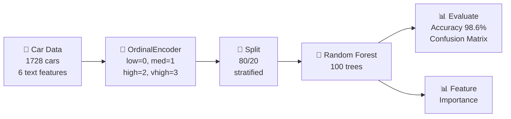

### Quick Viva Answers

| Question | Answer |
|----------|--------|
| What is a Random Forest? | Ensemble of many trees on bootstrap samples with random features → majority vote |
| What is bagging? | **B**ootstrap **Agg**regating — parallel models on random samples, reduces variance |
| Bagging vs Boosting? | Bagging = parallel, reduces variance. Boosting = sequential, reduces bias |
| Why random features at each split? | Decorrelates the trees → averaging works better |
| What is OOB error? | ~37% rows a tree didn't train on → free validation |
| What is Gini impurity? | Measures class mixing in a node. 0 = pure, 0.5 = max confusion |
| Why ordinal encoding, not one-hot? | Features have natural order (low < med < high) |
| Does RF need scaling? | **No!** Trees split on thresholds, scale doesn't matter |
| Why is vgood recall only 0.77? | Only 13 vgood cars in test — 1-2 mistakes = big recall drop |
| RF vs single tree? | RF = less overfitting, more accurate, but harder to interpret |

---

## Practical 6 — Q-Learning (Tic-Tac-Toe) 🎮

### What is Reinforcement Learning in one line?
**An agent learns by trial and error — play, get reward, update strategy, repeat.**

---

### 📘 What is Reinforcement Learning (RL)?

A **third type of ML** — different from supervised and unsupervised:

| Type | Learns from | Example |
|------|------------|---------|
| Supervised | Labeled data (X → y) | Predict fare from distance |
| Unsupervised | Patterns in data (no labels) | Group flowers into clusters |
| **Reinforcement** | **Rewards/punishments from actions** | **Learn Tic-Tac-Toe by playing** |

**Analogy:** Like training a dog 🐕 — you don't show it labeled examples. It tries things, gets treats (rewards) for good behavior and scolding (penalties) for bad → learns over time!

---

### 📘 The 5 Key RL Concepts

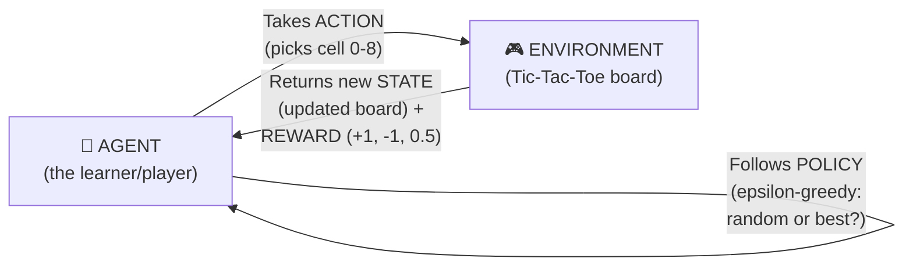

| Concept | In our code | Meaning |
|---------|-----------|---------|
| **Agent** | The Q-table player | The learner who makes decisions |
| **Environment** | Tic-Tac-Toe board | The world the agent interacts with |
| **State** | Tuple of 9 cells (0,1,2) | Current board position |
| **Action** | Pick an empty cell (0-8) | What the agent can do |
| **Reward** | +1 win, +0.5 draw, −1 loss | Feedback signal |
| **Policy** | Epsilon-greedy | Rule for choosing actions |

---

### 📘 What is a Q-Table?

A **lookup dictionary** that stores: *"How good is it to play this move in this board state?"*

| State (board) | Cell 0 | Cell 1 | Cell 2 | ... | Cell 8 |
|---|---|---|---|---|---|
| `(0,0,0,0,0,0,0,0,0)` (empty board) | 0.3 | 0.1 | 0.3 | ... | 0.1 |
| `(1,0,0,0,2,0,0,0,0)` (X top-left, O center) | — | **0.8** | 0.2 | ... | 0.5 |

- Higher value → better move
- Agent just picks the action with the **highest Q-value**
- Starts at 0 everywhere → learns through experience
- Our table learned **4520 states** after 30,000 games

---

### 📘 The Bellman Update — Heart of Q-Learning

$$Q(s,a) \leftarrow Q(s,a) + \alpha \times \Big[\underbrace{r + \gamma \times \max_{a'} Q(s',a')}_{\text{target}} - Q(s,a)\Big]$$

**In plain English:**

```
New Q = Old Q + learning_rate × (Target − Old Q)
```

Where **Target** = reward I got NOW + discount × best I can get NEXT

**Step by step:**
1. I'm in state `s`, I play action `a`
2. I get reward `r` and land in new state `s'`
3. **Target** = reward + γ × (best Q-value possible from s')
4. **Error** = Target − my old estimate
5. **Update** = nudge old estimate a little toward the target

**Two-player twist:** The opponent's next state gain is MY loss → so we **negate** it: target = −γ × best_q(opponent's view)

---

### 📘 What is Alpha (α = 0.3) — Learning Rate?

Controls **how much** each new experience changes the old belief:

| α Value | Behavior |
|---------|----------|
| **0** | Never learns (ignores new experience) |
| **0.3** (ours) | Balanced — learns steadily |
| **1** | Completely overwrites old value (forgets everything) |

**Analogy:** α = how much you trust the latest exam score vs your overall GPA.

---

### 📘 What is Gamma (γ = 0.95) — Discount Factor?

Controls **how much future rewards matter** vs immediate rewards:

| γ Value | Behavior |
|---------|----------|
| **0** | Only cares about immediate reward (short-sighted) |
| **0.95** (ours) | Future matters almost as much as now (plans ahead) |
| **1** | Future matters equally (very far-sighted) |

**Analogy:** γ = 0 is a child who wants candy NOW. γ = 0.95 is an adult who saves for retirement.

---

### 📘 What is Epsilon (ε) — Exploration Rate?

Chance of playing a **random** move instead of the best known move:

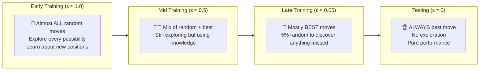

**In our code:** ε decays linearly from 1.0 → 0.05 over the first 80% (24,000) of 30,000 games.

---

### 📘 Exploration vs Exploitation — The Core Dilemma

| Exploration | Exploitation |
|---|---|
| Try random/new moves | Use the best known move |
| Might discover something better | Uses proven strategy |
| Wastes time if already optimal | Misses undiscovered better moves |
| **Essential early** in training | **Essential late** and during testing |

**Analogy:** Trying a new restaurant (explore) vs going to your favorite one (exploit). You need both!

---

### 📘 What is Self-Play?

The agent plays **both X and O** against itself, using one Q-table:

| Advantage | Why |
|-----------|-----|
| No human teacher needed | Learns from scratch |
| Opponent improves as agent improves | Progressively harder practice |
| Learns both sides of the game | One table serves both X and O |

---

### 📘 What is the `flip()` Trick?

The board is **flipped** so the current player always sees itself as "1" (X):

```
Real board: X _ O     flip() for O's turn: O _ X
            _ X _     →                    _ O _
            _ _ _                          _ _ _
```

**Why?** → ONE Q-table works for both X and O! The agent always thinks "I am player 1, what should I do?"

---

### 📘 Q-Learning vs SARSA vs DQN

| | Q-Learning (ours) | SARSA | DQN |
|---|---|---|---|
| **Update uses** | **Max** of next state (best possible) | **Actual** next action taken | Neural network |
| **Policy** | Off-policy (learns optimal even while exploring) | On-policy (learns the exploring policy) | Off-policy + experience replay |
| **State space** | Small/discrete (table) | Small/discrete (table) | Large/continuous (images, etc.) |
| **Behavior** | Aggressive/optimistic | More cautious/safe | Handles Atari, robotics |

---

### Training Results

| Stage | Wins | Draws | Losses | Games |
|-------|------|-------|--------|-------|
| **Before training** | 210 (42%) | 62 | 228 (46%) | 500 |
| **After training** | 909 (91%) | 89 | 2 (0.2%) | 1000 |

### Quick Viva Answers

| Question | Answer |
|----------|--------|
| What is RL? | Agent learns by trial & error through rewards, no labeled data |
| What is Q-learning? | Model-free, off-policy algorithm that learns Q(s,a) values |
| What is the Q-table? | Dictionary: state → list of action values. Pick the highest |
| Explain Bellman update? | New Q = Old Q + α × (reward + γ × best_next − Old Q) |
| What is α (alpha)? | Learning rate (0.3) — how much to trust new experience |
| What is γ (gamma)? | Discount factor (0.95) — how much future rewards matter |
| What is ε (epsilon)? | Exploration rate — chance of random move. 1.0 → 0.05 |
| Q-learning vs SARSA? | Q uses **max** next (off-policy). SARSA uses **actual** next (on-policy) |
| Why is it model-free? | Doesn't need game rules — learns from experience |
| Why tuple not list for board? | Tuples are **hashable** → can be dict keys in Q-table |
| Why loop backward? | So the final reward **travels back** to earlier moves |
| Why not 100% win rate? | Some rare positions not fully learned + agent plays 2nd in half games |
| What is self-play? | Agent plays both sides → learns without a teacher, opponent gets stronger too |
| Why flip the board? | So ONE Q-table works for both X and O (mover always sees itself as "1") |

---

## 🗺️ Cheat Sheet — All 6 Practicals at a Glance

| # | Practical | Type | Algorithm | Dataset | Key Metric | Result |
|---|-----------|------|-----------|---------|------------|--------|
| 1 | PCA | Unsupervised | PCA | Wine (178×13) | Explained Variance | 55.41% with 2 PCs |
| 2 | Regression | Supervised | Linear/Ridge/Lasso | Uber (200K rides) | R², RMSE | R²≈0.49, RMSE≈$2.95 |
| 3 | SVM | Supervised | SVC (RBF kernel) | Digits (1797×64) | Accuracy | 98% |
| 4 | K-Means | Unsupervised | K-Means | Iris (150×4) | Silhouette, ARI | 0.553, 0.73 |
| 5 | Random Forest | Supervised | RF (100 trees) | Car Eval (1728×6) | Accuracy | 98.6% |
| 6 | Q-Learning | Reinforcement | Q-Learning | Self-play TTT | Win rate | 91% wins |

### The 3 Types of ML

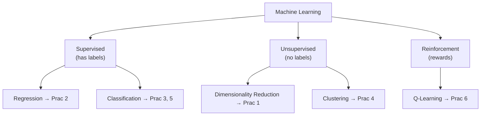

> [!IMPORTANT]
> **Before your exam, remember these universal steps:**
> 1. **Load data** → `pd.read_csv()` or `load_*()` from sklearn
> 2. **Clean/preprocess** → handle NaN, encode categories, scale features
> 3. **Split** → `train_test_split()` (only for supervised)
> 4. **Train** → `.fit()` on training data
> 5. **Evaluate** → `.predict()` + metrics on test data
> 6. **Visualize** → matplotlib plots

Good luck with your exam! 🍀
